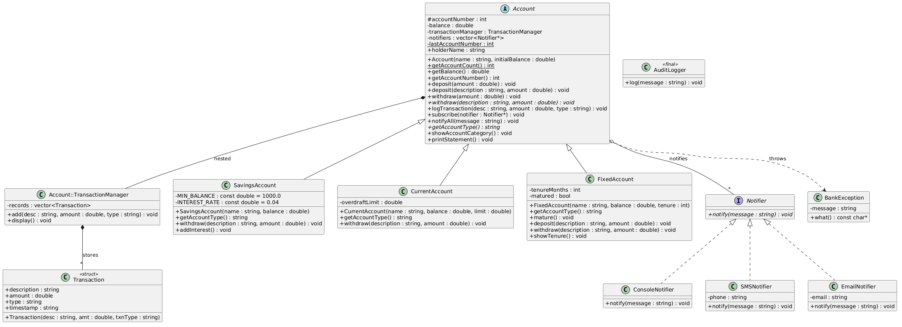
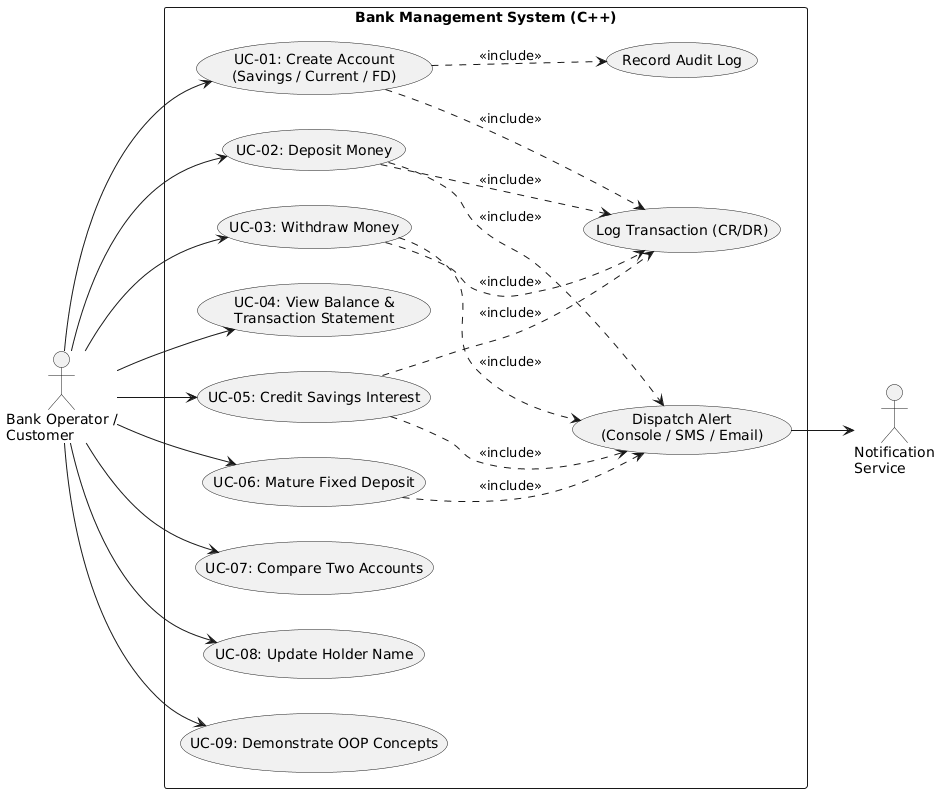
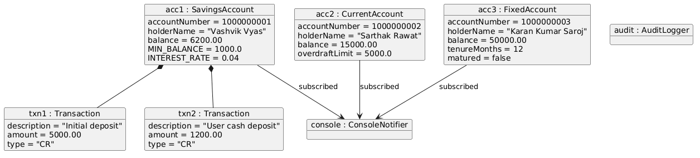
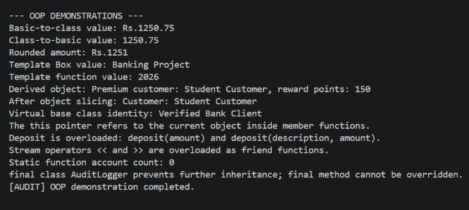

# Bank Management System (C++)

A console-based **Bank Management System** built in modern C++ for **CS201**, demonstrating core and advanced **Object-Oriented Programming (OOP)** principles, polymorphic account hierarchies, custom exception handling, operator overloading, and observer-based transaction notifications.

---

## Key Features

- **Multi-Account Architecture:** Supports **Savings** (4% interest, Rs. 1,000 minimum balance), **Current** (configurable overdraft limit), and **Fixed Deposit** (tenure lock until maturity) accounts.
- **Real-Time Transaction Ledger:** Tracks credits (`CR`), debits (`DR`), descriptions, and system timestamps per account via a nested `TransactionManager`.
- **Observer Notification System:** Extensible `Notifier` interface (`ConsoleNotifier`, `SMSNotifier`, `EmailNotifier`) triggered automatically on account activity.
- **Custom Exception Hierarchy:** Dedicated domain exceptions (`InsufficientBalanceException`, `MinimumBalanceException`, `AccountLockedException`, `OperationNotAllowedException`, `InvalidAmountException`, `InvalidAccountException`) inheriting from `BankException`.
- **Interactive OOP Sandbox (Menu Option 12):** Built-in demonstration of type conversions, templates, object slicing, virtual base classes, `final` classes/methods, and runtime polymorphism.

---

## OOAD Documentation & UML Diagrams

All Object-Oriented Analysis and Design (OOAD) artifacts, PlantUML source files, and rendered diagrams are organized inside the [`docs/`](docs/) directory:

### Design & Analysis Documents
| Artifact | Description | Source / Diagram |
| :--- | :--- | :--- |
| **Noun-Verb Analysis** | Candidate class, attribute, and method extraction from the problem statement | [`docs/noun_verb_analysis.md`](docs/noun_verb_analysis.md) |
| **CRC Cards** | Class-Responsibility-Collaborator mappings across the system | [`docs/CRC_CARDS.md`](docs/CRC_CARDS.md) |
| **Use Case Specifications** | Detailed actor flows, preconditions, and exception scenarios (`UC-01` to `UC-06`) | [`docs/USECASE_specifications.md`](docs/USECASE_specifications.md) |
| **Use Case Diagram** | System boundary, actors, and `<<include>>` relationships | [`Use_case_diagram.puml`](docs/Use_case_diagram.puml) · [`USE_CASE_DIAGRAM.png`](docs/USE_CASE_DIAGRAM.png) |
| **Domain Class Diagram** | Full class hierarchy, associations, compositions, and exception dependencies | [`domain_class_diagram.puml`](docs/domain_class_diagram.puml) · [`DOMAIN_classdiagram.png`](docs/DOMAIN_classdiagram.png) |
| **Object Diagram** | Runtime snapshot of active account instances, transactions, and observers | [`object_diagram.puml`](docs/object_diagram.puml) · [`CLASS_DIAGRAM.png`](docs/CLASS_DIAGRAM.png) |

---

### Rendered UML Diagrams

#### 1. Domain Class Diagram


#### 2. Use Case Diagram


#### 3. Object Diagram (Runtime Snapshot)


---

## OOP Concepts Implemented

| OOP Concept | Implementation in Codebase |
| :--- | :--- |
| **Abstraction & Pure Virtual Functions** | `Account` (`withdraw`, `getAccountType`) and `Notifier` (`notify`) |
| **Inheritance & Runtime Polymorphism** | `SavingsAccount`, `CurrentAccount`, `FixedAccount` managed via `vector<unique_ptr<Account>>` |
| **Virtual Base Class (Diamond Problem)** | `BankCustomer` and `BankUser` virtually inherit from `Identity` into `VerifiedClient` |
| **Encapsulation & Nested Classes** | Private `balance` and nested `Account::TransactionManager` storing `Transaction` records |
| **RAII / Deterministic Cleanup** | `CleanupGuard` destructor releases resources automatically on scope exit |
| **Custom Exception Hierarchy** | `BankException` base class with 6 specialized derived exception classes |
| **Operator Overloading (`friend`)** | Relational (`>`, `<`, `==`) for balance comparison and stream (`<<`, `>>`) operators |
| **Function Overloading** | `deposit(double)` and `deposit(const string&, double)` |
| **Type Conversions** | `Amount` (basic-to-class, class-to-basic) and `RoundedAmount` (class-to-class) |
| **Templates** | Class template `Box<T>` and function template `showValue<T>()` |
| **`final` Specifier** | `AuditLogger final` class and `Account::showAccountCategory() const final` |
| **RTTI (`dynamic_cast`)** | Safe downcasting from `Account*` to `SavingsAccount*` and `FixedAccount*` |
| **Object Slicing Demonstration** | `PremiumCustomerRecord` assigned by value to `CustomerRecord` in Option 12 |

---

## How to Clone & Run Locally

### Prerequisites
- **Git** installed on your system
- A **C++14 / C++17** compatible compiler (`g++`, `clang++`, or MinGW on Windows)

### Step 1: Clone the Repository
Open your terminal or command prompt and clone the repository:
```bash
git clone [https://github.com/KumarrKaran7/Bank-Management-System.git](https://github.com/KumarrKaran7/Bank-Management-System.git)
cd Bank-Management-System
```

### Step 2: Compile and Run

#### Option A: Using `Makefile` (Linux / macOS / Windows with `make`)
```bash
make run
```

#### Option B: Using `g++` Directly (Linux / macOS)
```bash
g++ -std=c++17 -Wall -Wextra src/main.cpp -o bank_system
./bank_system
```

#### Option C: Using `g++` on Windows (Command Prompt / PowerShell)
```bash
g++ -std=c++17 -Wall -Wextra src/main.cpp -o bank_system.exe
bank_system.exe
```

#### Option D: Run in Browser via GitHub Codespaces (No Local Setup)
1. Click the green **`<> Code`** button at the top of this repository.
2. Open the **Codespaces** tab and click **Create codespace on main**.
3. Once the terminal loads, type `make run` to launch the program immediately.

---

## Sample Output

### 1. Main Menu & Account Creation


### 2. Account Statement & Transaction Ledger


### 3. OOP Concepts Demonstration (Option 12)


---

## Team Members & Contributions

| Role | Name | Roll Number | GitHub | Module / Responsibility |
| :--- | :--- | :--- | :--- | :--- |
| **Team Leader** | Vashvik Vyas | `20251501172` | — | Core `Account` Hierarchy & Polymorphism |
| **Member** | Karan Kumar Saroj | `20251502039` | [@KumarrKaran7](https://github.com/KumarrKaran7) | Custom Exception Hierarchy, RTTI & Input Validation |
| **Member** | Sarthak Rawat | `20251501155` | [@sarthakdev01](https://github.com/sarthakdev01) | Repository Setup, Build Configuration (`Makefile`) & CLI Integration |
| **Member** | Ravaliya Raj Mahendrabhai | `20251501142` | — | `TransactionManager` Ledger & `Notifier` Observer System |
| **Member** | Vikas Chand Bairwa | `20251501175` | — | Operator Overloading, Templates & Type Conversions |
