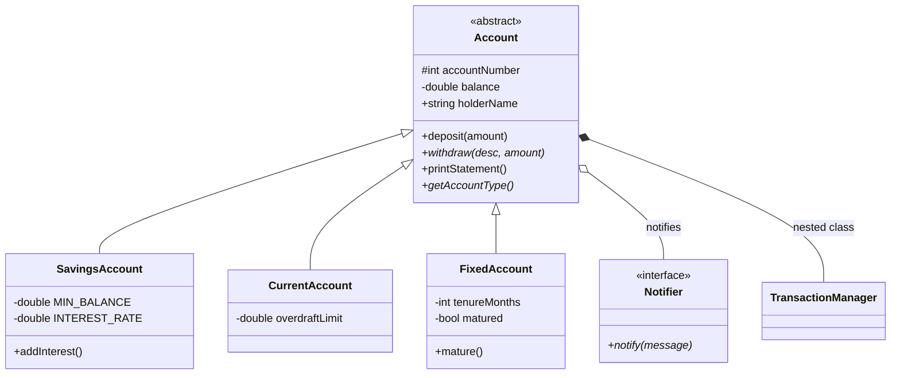

# Banking Management System (C++)

A console-based **Banking Management System** built in modern C++ demonstrating core and advanced **Object-Oriented Programming (OOP)** principles, polymorphic account hierarchies, custom exception handling, operator overloading, and observer-based transaction notifications.

---

## Key Features

- **Multi-Account Architecture:** Supports **Savings** (4% interest, Rs. 1,000 minimum balance), **Current** (configurable overdraft limit), and **Fixed Deposit** (tenure lock until maturity) accounts.
- **Real-Time Transaction Ledger:** Tracks credits (`CR`), debits (`DR`), descriptions, and system timestamps per account via a nested `TransactionManager`.
- **Observer Notification System:** Extensible `Notifier` interface (`ConsoleNotifier`, `SMSNotifier`, `EmailNotifier`) triggered automatically on account activity.
- **Custom Exception Hierarchy:** Dedicated domain exceptions (`InsufficientBalanceException`, `MinimumBalanceException`, `AccountLockedException`, `OperationNotAllowedException`, `InvalidAmountException`, `InvalidAccountException`) inheriting from `BankException`.
- **Interactive OOP Sandbox (Menu Option 12):** Built-in demonstration of type conversions, templates, object slicing, virtual base classes, `final` classes/methods, and runtime polymorphism.

---

## Class Architecture



---

## OOP Concepts Implemented

| OOP Concept | Implementation in Codebase |
| :--- | :--- |
| **Abstraction & Pure Virtual Functions** | `Account` (`withdraw`, `getAccountType`) and `Notifier` (`notify`) |
| **Inheritance & Runtime Polymorphism** | `SavingsAccount`, `CurrentAccount`, `FixedAccount` managed via `vector<unique_ptr<Account>>` |
| **Virtual Base Class (Diamond Problem)** | `BankCustomer` and `BankUser` virtually inherit from `Identity` into `VerifiedClient` |
| **Encapsulation & Nested Classes** | Private `balance` and nested `Account::TransactionManager` storing `Transaction` records |
| **RAII / Deterministic Cleanup** | `CleanupGuard` destructor releases resources automatically on scope exit |
| **Custom Exception Hierarchy** | `BankException` base class with 6 specialized derived exception classes |
| **Operator Overloading (`friend`)** | Relational (`>`, `<`, `==`) for balance comparison and stream (`<<`, `>>`) operators |
| **Function Overloading** | `deposit(double)` and `deposit(const string&, double)` |
| **Type Conversions** | `Amount` (basic-to-class, class-to-basic) and `RoundedAmount` (class-to-class) |
| **Templates** | Class template `Box<T>` and function template `showValue<T>()` |
| **`final` Specifier** | `AuditLogger final` class and `Account::showAccountCategory() const final` |
| **RTTI (`dynamic_cast`)** | Safe downcasting from `Account*` to `SavingsAccount*` and `FixedAccount*` |
| **Object Slicing Demonstration** | `PremiumCustomerRecord` assigned by value to `CustomerRecord` in Option 12 |

---

## Build & Run Instructions

### Prerequisites
- A C++14 or C++17 compatible compiler (`g++`, `clang++`, or MSVC)

### Using `g++` (Linux / macOS / Windows MinGW)
```bash
g++ -std=c++17 -Wall -Wextra src/main.cpp -o bank_system
./bank_system
```

### Using `Makefile`
```bash
make run
```

---

## Team Members & Contributions

| Name | Roll Number | GitHub | Module / Responsibility |
| :--- | :--- | :--- | :--- |
| Member 1 | — | `@username1` | Core `Account` Hierarchy & Polymorphism |
| Member 2 | — | `@username2` | Custom Exception Handling & Input Validation |
| Member 3 | — | `@username3` | `TransactionManager` & `Notifier` Observer System |
| Member 4 | — | `@username4` | Operator Overloading, Templates & Type Conversions |
| Member 5 | — | `@username5` | CLI Menu Integration, Testing & Documentation |
